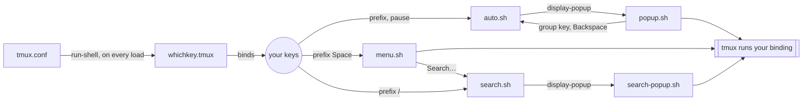

# whichkey-tmux

[](https://github.com/aguiar-arthur/whichkey-tmux/actions/workflows/ci.yml)

**Press the prefix. Pause. See every key you can press next.**

which-key for tmux, built from the bindings you already have. There are no
menus to write and nothing to keep in sync, and the plugin is the only thing
you install.


## Why you will like it

- **Nothing to configure, and always accurate.** whichkey-tmux reads your
  live bindings every time it opens. Change `tmux.conf`, reload, and the
  popup already knows. Your config is the only source of truth.
- **It shows up only when you hesitate.** At full speed you never see it.
  Pause after the prefix and the keys you can press appear.
- **It never gets in your way.** Every key you press in the popup goes
  straight to tmux, listed or not. Escape closes it.
- **The real key next to every action.** You learn the shortcut while you use
  it, so the next time you do not need the popup.
- **Groups you can find your way around.** A key that opens another key table
  shows as `+window` and gets its own popup. The title shows where you are
  (`prefix › window`), and Backspace goes back up.
- **Search.** Type a few letters to find any binding: in the prefix table,
  inside groups, or bound without a prefix. Each result shows the whole key
  sequence (`C-b w n`). Enter runs it.
- **Useful from the first minute.** On a fresh tmux the popup shows tmux's
  own bindings. Once you add yours, it shows yours.
- **A built-in health check.** `doctor.sh` confirms the setup works. It also
  lists bindings that have no description and the tmux defaults you have
  replaced.
- **Runs your binding exactly as if you typed it.** Choosing from a menu
  presses the key, so repeat (`-r`) bindings and everything else behave as
  usual.
- **Pure bash, nothing else to install.** It works with the bash 3.2 that
  ships with macOS. It does not need Python, jq or fzf, and has no build step.
- **Tested on every tmux it supports.** The CI tests every release from 3.4
  to 3.8, on Linux and macOS, with real clients on real terminals.

## Install

Requires tmux 3.4 or newer.

**[TPM](https://github.com/tmux-plugins/tpm):** add to `tmux.conf`, then
press `prefix I`:

```tmux
set -g @plugin 'aguiar-arthur/whichkey-tmux'
set -g @whichkey-auto on          # the popup after a pause on the prefix
set -g @whichkey-search-key /     # optional: prefix / searches
```

**Manually:** clone the repository, add this to the end of `tmux.conf`, and
reload (`tmux source-file ~/.tmux.conf`):

```tmux
set -g @whichkey-auto on
run-shell ~/path/to/whichkey-tmux/whichkey.tmux
```

Then run the health check once:

```sh
~/.tmux/plugins/whichkey-tmux/scripts/doctor.sh
```

## Usage

| You press | You get |
|---|---|
| the prefix, then pause | a popup with the keys of the prefix table, yours first |
| a key in the popup | that key's binding, as if the popup were not there |
| a `+group` key | that group's popup, titled `prefix › group` |
| Backspace in a group | the popup one level up |
| Escape | the popup closes |
| `prefix Space` | the catalog: a menu of every binding, yours first, then tmux's |
| Search… at the end of the catalog, or `prefix /` with `@whichkey-search-key /` | the search |

**Search:** start typing. Results that contain what you typed come first,
followed by those that contain its letters in order (`sw` finds "Split
window"). Move with ↑/↓ (or `C-n`/`C-p`), press Enter to run the selected
binding, or Escape to close. Backspace deletes a letter, `C-u` the whole
query.

### Describe your bindings

Labels come from binding notes. Add `-N` and your bindings read like a menu,
in the popup, the catalog, the search and tmux's own `prefix ?`:

```tmux
bind -N "Lazygit" G display-popup -E lazygit
bind -N "+git" g switch-client -T git
bind -T git -N "Status" s display-popup -E "git status | less"
```

A binding without a note shows its command instead. `doctor.sh` lists those
bindings.

### Get started with groups

[`examples/starter.conf`](examples/starter.conf) has three noted groups,
`W` window, `P` pane and `S` session. They add to tmux's defaults and replace
none. Copy what you like, or load the whole file before the plugin:

```tmux
source-file ~/.tmux/plugins/whichkey-tmux/examples/starter.conf
```

## Options

| Option | Default | |
|---|---|---|
| `@whichkey-auto` | `off` | Show the popup after a pause on the prefix |
| `@whichkey-delay` | `200` | Milliseconds to wait before the popup |
| `@whichkey-popup-defaults` | `auto` | tmux's own bindings in the popup: `auto` when your config binds none in that table, `on` always (after yours), `off` never |
| `@whichkey-key` | `Space` | Key in the prefix table that opens the catalog |
| `@whichkey-root-key` | unset | Key in the root table (no prefix) that opens the catalog, e.g. `M-Space` |
| `@whichkey-search-key` | unset | Key in the prefix table that opens the search, e.g. `/` (tmux binds `/` to "describe key" by default) |
| `@whichkey-exclude` | tmux's digit, arrow and `M-1`..`M-5` bindings | Extended regex of keys to hide from the catalog and the search. The default never hides your own bindings; `'^$'` shows everything |
| `@whichkey-label-width` | `40` | Truncate labels longer than this |
| `@whichkey-x` / `@whichkey-y` | `C` / `S` | Catalog position, as in `display-menu -x/-y` |
| `@whichkey-key-style` | `fg=magenta,bold` | Style of keys in the popup and the search |
| `@whichkey-group-style` | `fg=blue` | Style of `+group` labels in the popup |
| `@whichkey-border-lines` | `rounded` | Popup and search border, as in `display-popup -b` |
| `@whichkey-debug` | `off` | Trace every run into `~/.cache/whichkey-tmux/debug.log` |

The catalog and the popup frames use tmux's own `menu-*` and `popup-*`
styles. To have them follow your terminal's colour scheme (tmux 3.6+):

```tmux
set -g theme terminal
```

## Health check

```sh
~/.tmux/plugins/whichkey-tmux/scripts/doctor.sh
```

Run it in a tmux pane, or from tmux with `prefix :` and
`run-shell <path>/scripts/doctor.sh`. It checks the tmux version and that
each key the plugin bound still does its job. It notices, for example, when
something set the prefix after the plugin loaded. Then it lists your bindings
without a note and the tmux defaults you have replaced. It exits with the
number of problems found, so it also works in scripts.

```text
Setup:
  ✓ tmux 3.8, bash 3.2.57(1)-release
  ✓ catalog: prefix Space
  ✓ popup after 200 ms on C-b (prefix)

Your bindings without a note (bind -N "What it does" ...):
  ✓ every binding of yours has a note

Your bindings that replace one of tmux's:
    prefix         c        was: Create a new window
```

## How it works

tmux handles the prefix key internally, with no hook to attach a timer to.
In auto mode the plugin sets `prefix None` (and `prefix2`, if you use one) and
binds the key itself, in the root and copy-mode tables. The binding switches
to the prefix table and checks back after the delay. `#{client_prefix}` keeps
working, and a `send-prefix` binding is replaced by one that sends the key.

tmux has no "a key was pressed" signal either. So the popup only appears if
the client is still waiting and nothing changed since the prefix: the same
session, window, active pane and layout. A repeat (`-r`) binding that changes
none of these could still let the popup appear.

"Your bindings" are the ones that differ from a tmux started without a
config. That list is read once per tmux version and cached in
`~/.cache/whichkey-tmux`.

## Troubleshooting

Start with `scripts/doctor.sh`: it names most problems and how to fix them.

**The popup never shows.** Reload the config (`tmux source-file
~/.tmux.conf`). Auto mode is set up when the plugin loads, so load it after
anything else that sets the prefix.

**Something else is wrong.** `set -g @whichkey-debug on`, reload, reproduce,
and look at `~/.cache/whichkey-tmux/debug.log`. The log contains the commands
of your bindings and only you can read it. Check it for anything private
before attaching it to an issue.

## Uninstall

Auto mode changes the `prefix` option, and a config reload does not undo
that by itself. Before removing the plugin, set `@whichkey-auto off` and
reload once, which restores your prefix. Or restart the tmux server
afterwards (`tmux kill-server`).

## Development

```sh
make lint   # shellcheck and shfmt
make test   # unit tests (no tmux server, under a second) and e2e (~30 s)
```

`tests/e2e.sh` starts a private tmux server with real clients on
pseudo-terminals. It presses keys, types raw bytes, and checks that the
bindings fire. Everything must run on bash 3.2.

How it is built and why: [docs/architecture.md](docs/architecture.md),
[docs/decisions.md](docs/decisions.md),
[docs/tmux-compatibility.md](docs/tmux-compatibility.md),
[docs/testing.md](docs/testing.md). Rules for changes, for people and AI
agents: [CLAUDE.md](CLAUDE.md). See also [CONTRIBUTING.md](CONTRIBUTING.md).

## Project structure

What each key press sets off:



Each of `popup.sh`, `menu.sh` and `search-popup.sh` ends the same way: it
presses your key again with `send-keys`, and tmux runs the binding as if you
had typed it.

```text
whichkey-tmux/
├── whichkey.tmux            entry point: binds the keys, takes over the prefix in auto mode
├── scripts/
│   ├── auto.sh              after the pause: still waiting? then lay out the popup
│   ├── popup.sh             inside the popup: draw, read one key, hand it to tmux
│   ├── menu.sh              the catalog (display-menu), one table and page at a time
│   ├── search.sh            gathers every binding and opens the search
│   ├── search-popup.sh      inside the search: filter as you type, run the choice
│   ├── doctor.sh            health check of the setup and your bindings
│   └── lib/
│       ├── bindings.sh      reads key tables on every tmux 3.4–3.8, yours vs tmux's
│       ├── automode.sh      prefix trigger, sequence numbers, state snapshot
│       ├── input.sh         raw keyboard input inside a popup
│       ├── keys.sh          terminal bytes → tmux key names, and back
│       ├── match.sh         search matching
│       ├── layout.sh        grid, pages and scrolling arithmetic
│       ├── style.sh         tmux styles → terminal colours
│       ├── quote.sh         quoting for sh, the tmux parser and formats
│       ├── tmux.sh          many tmux values in one call, version checks
│       ├── options.sh       every option's default
│       └── debug.sh         @whichkey-debug tracing
├── examples/starter.conf    noted groups to start from
├── tests/
│   ├── unit.sh              pure functions, with a fake tmux
│   ├── e2e.sh               a private tmux server with real clients
│   └── pty_run.py           a real terminal for each test client
└── docs/                    architecture, decisions, compatibility, testing, demo
```

## License

[MIT](LICENSE)
