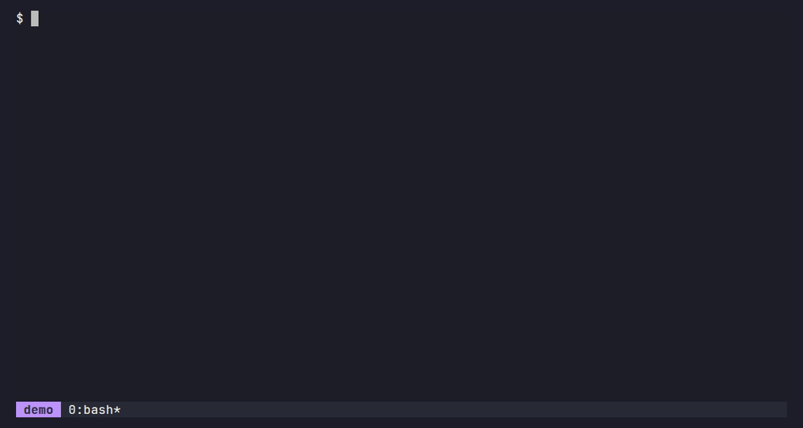

# whichkey-tmux

[](https://github.com/aguiar-arthur/whichkey-tmux/actions/workflows/ci.yml)

which-key for tmux, built from the bindings you **already have**. Press the
prefix and pause, and a popup lists what you can press next; `prefix Space`
opens a catalog of every binding.



- **No extra config.** It reads `tmux list-keys` each time, so it always
  matches your config. Labels come from binding notes
  (`bind -N "Lazygit" G ...`), falling back to the command itself.
- **Never in the way.** In the popup, every key goes straight to tmux, listed
  or not. Typing at full speed never shows the popup at all.
- **Your bindings first.** The popup shows only the bindings your config
  defines (tmux's ~90 defaults are left out); the catalog lists yours, then
  the defaults.
- **Groups.** A key that switches to another key table
  (`bind w switch-client -T window`) shows as `+window` and gets its own
  popup or submenu.
- **Exact replay.** Choosing a menu item presses its key with `send-keys -K`,
  so the binding runs exactly as if typed, `-r` repeat bindings included.

Requires tmux 3.4 or newer and bash (3.2, the macOS system bash, is fine).
Tested on Linux and macOS with every tmux release from 3.4 to 3.8.

## Install

With [TPM](https://github.com/tmux-plugins/tpm), add to `tmux.conf`:

```tmux
set -g @plugin 'aguiar-arthur/whichkey-tmux'
set -g @whichkey-auto on   # the popup after a pause on the prefix
```

then press `prefix I`.

Manually, clone the repository and add to the end of `tmux.conf`:

```tmux
set -g @whichkey-auto on
run-shell ~/path/to/whichkey-tmux/whichkey.tmux
```

then reload: `tmux source-file ~/.tmux.conf`.

## Usage

**Popup** (with `@whichkey-auto on`): press the prefix and wait
`@whichkey-delay` milliseconds. Press any key to run its binding, `Escape`
to cancel.

**Catalog**: `prefix Space` opens a menu of every binding in the prefix table.
Pick an item with its key, or the arrow keys and `Enter`. Long menus have
pages (`C-n` / `C-p`, or `NPage` / `PPage` if you bound those).

Give your bindings notes so they read well in both, and in `prefix ?`:

```tmux
bind -N "Lazygit" G display-popup -E lazygit
bind -N "+git" g switch-client -T git
```

## Options

| Option | Default | |
|---|---|---|
| `@whichkey-auto` | `off` | Show the popup after a pause on the prefix |
| `@whichkey-delay` | `200` | Milliseconds to wait before the popup |
| `@whichkey-key` | `Space` | Key in the prefix table that opens the catalog |
| `@whichkey-root-key` | unset | Key in the root table (no prefix) that opens the catalog, e.g. `M-Space` |
| `@whichkey-exclude` | tmux's digit, arrow and `M-1`..`M-5` bindings | Extended regex of keys to hide from the catalog. The default never hides your own bindings; `'^$'` shows everything |
| `@whichkey-label-width` | `40` | Truncate labels longer than this |
| `@whichkey-x` / `@whichkey-y` | `C` / `S` | Catalog position, as in `display-menu -x/-y` |
| `@whichkey-key-style` | `fg=magenta,bold` | Style of keys in the popup |
| `@whichkey-group-style` | `fg=blue` | Style of `+group` labels in the popup |
| `@whichkey-border-lines` | `rounded` | Popup border, as in `display-popup -b` |
| `@whichkey-debug` | `off` | Trace every run into `~/.cache/whichkey-tmux/debug.log` |

The catalog and the popup frame use tmux's own `menu-*` and `popup-*` style
options. To have them follow your terminal's colour scheme (tmux 3.6+):

```tmux
set -g theme terminal
```

## How it works

tmux handles the prefix key internally, with no hook to attach a timer to.
So auto mode sets `prefix None` (and `prefix2`, if you use one) and binds the
key itself, in the root and copy-mode tables, to switch to the prefix table
and check back after the delay. `#{client_prefix}` keeps working, and a
`send-prefix` binding is replaced by one that sends the key.

tmux has no "a key was pressed" signal either, and after a repeat (`-r`)
binding such as `bind -r H resize-pane -L` the client stays in the prefix
table. So the popup only shows if the session, window, active pane and layout
are unchanged since the prefix: a repeat binding that changes none of these
could still let the popup appear.

"Your bindings" are the ones that differ from a config-less tmux. That list
is read once per tmux version and cached in `~/.cache/whichkey-tmux`.

### Compared with tmux-which-key

[tmux-which-key](https://github.com/alexwforsythe/tmux-which-key) builds its
menu from a YAML file you maintain alongside `tmux.conf`. whichkey-tmux has no
menu definition: it reads the bindings you already have, adds the popup after
a pause on the prefix, and leaves `tmux.conf` as the single source of truth.

## Troubleshooting

**The popup never shows.** Reload the config (`tmux source-file
~/.tmux.conf`); auto mode is set up when the plugin loads. Then
`tmux show -g prefix` should print `None`, and `tmux list-keys -T root C-b`
(your prefix) should mention `auto.sh`. Load the plugin after anything else
that sets the prefix.

**Something else is wrong.** `set -g @whichkey-debug on`, reload, reproduce,
and look at (or attach to an issue) `~/.cache/whichkey-tmux/debug.log`.

## Uninstall

Auto mode changes the `prefix` option, and a config reload does not undo
that by itself. Before removing the plugin, set `@whichkey-auto off` and
reload once, which restores your prefix. Or restart the tmux server
afterwards (`tmux kill-server`).

## Development

```sh
make lint   # shellcheck and shfmt
make test   # unit tests (no tmux server, under a second) and e2e (~20 s)
```

`tests/e2e.sh` starts a private tmux server with real clients on
pseudo-terminals, presses keys and types raw bytes, and checks the bindings
fire. Everything must run on bash 3.2. See [CONTRIBUTING.md](CONTRIBUTING.md)
for the code layout.

## License

[MIT](LICENSE)
